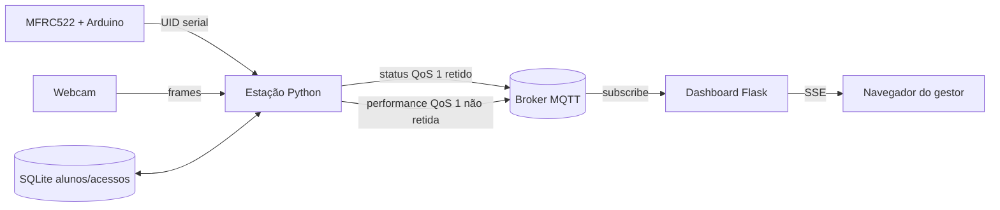

# Smart Gym — Checkpoint 05 (FIAP)

Estação inteligente de treino que identifica o aluno por RFID, acompanha **rosca bíceps** com webcam, MediaPipe e detecção de equipamento com YOLO, conta repetições completas e transmite ocupação/performance por MQTT. Um dashboard Flask assina os tópicos e atualiza o navegador por SSE, sem refresh manual. Esta versão amplia o CP4 existente.

## Equipe

| Integrante | RM |
| --- | --- |
| Lorenzo Hayashi Mangini | 554901 |
| Milton Cezar Bacanieski | 555206 |
| Vitor Bebiano Mulford | 555026 |
| Victorio Maia Bastelli | 554723 |

Disciplina: Physical Computing — IoT & IoB, turma 3ESPZ. Entrega do CP05: 19/10/2026.

## O que faz

- Arduino Uno/Nano + MFRC522 envia UID por USB serial. O Python normaliza o UID e consulta apenas alunos **ativos** no SQLite. UID desconhecido ou inativo não ocupa a estação.
- O login muda a estação para `OCUPADA` e publica status MQTT imediatamente após a validação. O status é retido no broker e inclui nome do aluno.
- A câmera acompanha ombro, cotovelo e pulso. O contador de rosca bíceps do CP4 exige extensão → flexão → extensão e equipamento detectado para contar uma repetição.
- Ao atingir a meta cadastrada, a estação publica **um** evento de performance com aluno, exercício, repetições, série e horário. Após a tela de conclusão de 3 segundos, encerra a sessão e publica `LIVRE`. A tecla `Q` também encerra a sessão ativa.
- O dashboard recebe eventos do broker em uma conexão MQTT própria, mostra verde para `LIVRE`, vermelho para `OCUPADA` e mantém as últimas 100 séries em memória. SSE envia as mudanças ao navegador.
- Em falhas temporárias de MQTT, a contagem local continua; o status mais recente é sincronizado após reconexão. Até 200 eventos de performance gerados durante a desconexão ficam em memória para reenvio. IDs de evento evitam duplicações na tabela.

## Arquitetura



O Arduino atual só lê RFID; o **script Python** é o Publisher, conforme o CP05. `python/app.py` mantém a máquina de estados do CP4. `station_events.py` forma os eventos; `mqtt_publisher.py` cuida da conexão e reconexão. `dashboard.py` assina os tópicos e valida JSON antes de atualizar a interface. A Aula 10 foi usada como referência para Paho MQTT, estado retido e supervisório Flask.

```text
AGUARDANDO_ID --RFID ativo--> PRONTA_PARA_USO --pose--> TREINO_EM_CURSO
TREINO_EM_CURSO --meta atingida--> TREINO_CONCLUIDO --3 s/logout--> AGUARDANDO_ID
```

## Estrutura

```text
arduino/rfid_reader/rfid_reader.ino  firmware MFRC522
assets/pose_landmarker_full.task   modelo MediaPipe
mqtt/mosquitto.conf                broker local de demonstração
python/app.py                      estação e fluxo do CP4
python/config.py                   câmera/serial/limiares/modelos/carga inicial
python/database.py                 alunos e acessos SQLite
python/serial_io.py                leitura RFID serial
python/pose_detector.py            pose MediaPipe
python/equipment_detector.py       detecção YOLO de equipamento
python/exercise_counter.py         contagem da rosca bíceps
python/ui.py                       interface local Tkinter/OpenCV
python/mqtt_config.py              configuração MQTT por ambiente
python/mqtt_publisher.py           Publisher MQTT
python/station_events.py           eventos de sessão e performance
python/dashboard.py                Subscriber Flask/SSE
python/templates/dashboard.html    interface web
python/seed_db.py                  carga inicial de alunos
python/test_rfid.py                diagnóstico isolado do leitor
tests/test_cp5.py                  testes automatizados sem hardware
tests/integration_mqtt.py          smoke test com broker real
```

## Pré-requisitos

- Python **3.12** para as versões de MediaPipe, NumPy, OpenCV e Ultralytics deste projeto. Python 3.13 não foi validado com todas as dependências de visão.
- Git instalado e acesso à internet na instalação: o pacote CLIP usado pelo YOLO-World é obtido do repositório da Ultralytics. Na primeira carga das classes, o CLIP baixa aproximadamente 338 MB de pesos de texto.
- Mosquitto (ou broker MQTT compatível), porta 1883 acessível pela estação e dashboard.
- Webcam, Arduino Uno/Nano com sketch `arduino/rfid_reader/rfid_reader.ino`, leitor MFRC522 e tag cadastrada para validação física. Ligue SDA→D10, SCK→D13, MOSI→D11, MISO→D12, RST→D9, 3.3V→3.3V e GND→GND. Instale a biblioteca Arduino `MFRC522`.
- Ambiente gráfico para janelas OpenCV/Tkinter. O modelo de pose está em `assets/`; os pesos YOLO constam em `python/`.

### Instalação

Na raiz deste repositório:

```bash
python3.12 -m venv .venv
source .venv/bin/activate                 # Windows PowerShell: .venv\Scripts\Activate.ps1
python -m pip install -r python/requirements.txt
```

Em Linux sem CUDA, pode instalar primeiro o PyTorch CPU para evitar downloads de dependências NVIDIA; veja os [comandos oficiais do PyTorch](https://pytorch.org/get-started/previous-versions/). Neste computador foi usada a combinação CPU `torch==2.12.0` e `torchvision==0.27.0`. Depois instale o `requirements.txt` normalmente.

Se o Python 3.12 se chamar `py` no Windows, use `py -3.12 -m venv .venv`. Em Linux, também instale o pacote do sistema `python3-tk` se faltar Tkinter. Feche o Monitor Serial da Arduino IDE antes de iniciar a estação.

### Broker MQTT remoto usado na demonstração

O broker MQTT da demonstração está em `3.135.234.101`, porta `1883`, e aceita conexão sem usuário e senha. Antes de iniciar o dashboard e a estação, defina o mesmo host nos dois terminais:

```powershell
$env:SMARTGYM_MQTT_HOST="3.135.234.101"
$env:SMARTGYM_MQTT_PORT="1883"
```

O prefixo padrão permanece `smartgym`, com os tópicos:

```text
smartgym/stations/estacao01/status
smartgym/stations/estacao01/performance
```

Para observar as mensagens diretamente:

```powershell
mosquitto_sub -h 3.135.234.101 -p 1883 -t "smartgym/stations/#" -v
```

### Broker local alternativo

Em outro terminal, na raiz do repositório:

```bash
mosquitto -c mqtt/mosquitto.conf -v
```

Essa configuração aceita conexões sem senha **somente em 127.0.0.1**; serve para estação e dashboard na mesma máquina. Se usar broker externo ou o fornecido em aula, configure o host/usuário/senha por ambiente. Não publique credenciais no repositório.

### Configuração por ambiente

| Variável | Padrão | Uso |
| --- | --- | --- |
| `SMARTGYM_MQTT_HOST` | `localhost` | Host do broker, igual nos dois processos |
| `SMARTGYM_MQTT_PORT` | `1883` | Porta TCP |
| `SMARTGYM_MQTT_USERNAME` / `SMARTGYM_MQTT_PASSWORD` | vazios | Autenticação opcional |
| `SMARTGYM_MQTT_PREFIX` | `smartgym` | Prefixo dos tópicos |
| `SMARTGYM_STATION_ID` | `estacao01` | Identificador único por estação |
| `SMARTGYM_SERIAL_PORT` | autodetecção | Porta serial, por exemplo `COM5` ou `/dev/ttyACM0` |
| `SMARTGYM_YOLO_IMAGE_SIZE` | `640` | Resolução da inferência em cada recorte de mão; `320` pode ajudar em CPU, com possível perda de detecção de objetos pequenos |
| `SMARTGYM_DASHBOARD_HOST` / `SMARTGYM_DASHBOARD_PORT` | `127.0.0.1` / `5000` | Endereço web |

Exemplo PowerShell para o broker da demonstração: `$env:SMARTGYM_MQTT_HOST="3.135.234.101"` e `$env:SMARTGYM_SERIAL_PORT="COM10"`. Em Bash: `export SMARTGYM_MQTT_HOST=3.135.234.101`. Execute estação e dashboard com o **mesmo** host/prefixo. Use IDs diferentes ao executar várias estações.

### Banco, dashboard e estação

No terminal com o ambiente ativado, na raiz:

```bash
python python/seed_db.py
python python/dashboard.py
```

Abra <http://127.0.0.1:5000>. Em outro terminal com o mesmo ambiente e variáveis MQTT:

```bash
python python/app.py
```

A primeira execução do app também cria o banco e preenche os alunos padrão se vazio. `seed_db.py` atualiza os dois alunos configurados em `python/config.py`; revise UIDs/metas antes de apresentar. A migração do CP4 adapta exercícios antigos para rosca bíceps.

## Tópicos e payloads

| Tópico | QoS | Retido | Momento |
| --- | --- | --- | --- |
| `smartgym/stations/{station_id}/status` | 1 | sim | inicial, login, logout e reconexão |
| `smartgym/stations/{station_id}/performance` | 1 | não | uma vez ao concluir a série |
| `smartgym/dashboard/sync/request` e `/ready` | 1 | não | sincronização do backlog após reconexão |

Status (exemplo; UUID e horário variam):

```json
{"event_id":"b25aee49-4f58-478e-a122-59048e55b311","station_id":"estacao01","status":"OCUPADA","student_id":1,"student_name":"Lucas","session_id":"7d0f86b2-a6db-4df8-bc0e-d2b519d9270d","timestamp":"2026-10-13T20:00:00+00:00"}
```

Performance:

```json
{"event_id":"352e8ef1-7a2e-4cdf-9db8-959659f32861","station_id":"estacao01","student_id":1,"student_name":"Lucas","exercise":"Rosca Biceps","repetitions":5,"series_id":"7d0f86b2-a6db-4df8-bc0e-d2b519d9270d-1","session_id":"7d0f86b2-a6db-4df8-bc0e-d2b519d9270d","timestamp":"2026-10-13T20:03:00+00:00"}
```

No logout, `status` volta a `LIVRE`, com `student_id`, `student_name` e `session_id` nulos. O dashboard usa o timestamp UTC para exibir horário local no navegador. Performance retida recebida indevidamente é descartada; QoS 1 pode duplicar mensagens, então `event_id` deduplica o histórico.

## RFID e demonstração presencial

1. Instale/compile o sketch e verifique a saída `UID:AA:BB:CC:DD` em 9600 baud. Feche o Monitor Serial.
2. Na raiz, inicie o broker, ative a venv, execute `python python/seed_db.py`, depois `python python/dashboard.py` e abra o navegador. Inicie `python python/app.py` em outro terminal.
3. Confirme estação **LIVRE** em verde no dashboard. Aproxime uma tag **não cadastrada**: o app informa UID não cadastrado, o dashboard continua livre.
4. Aproxime uma tag ativa cujo UID foi cadastrado em `python/config.py` ou SQLite. Verifique registro de acesso, nome no painel local e **OCUPADA** em vermelho no dashboard sem atualizar a página.
5. Mostre o objeto de treino à câmera e faça roscas completas até a meta. O contador do CP4 só avança com pose e equipamento válidos. Antes da meta, nenhuma nova linha deve aparecer no histórico.
6. Na última repetição, confira uma linha com aluno, estação, repetições, horário e série. Após 3 s, o dashboard retorna para **LIVRE**. Opcionalmente, pressione `Q` durante uma sessão para demonstrar logout antecipado.
7. Para explicar a arquitetura, observe `smartgym/stations/#` no MQTT Explorer ou `mosquitto_sub -h 3.135.234.101 -p 1883 -t 'smartgym/stations/#' -v` em outro terminal.

A tecla **L** na janela da webcam já existia no CP4 como **RFID simulado para desenvolvimento**: ela passa o UID configurado pela mesma consulta SQLite. Pode ajudar a ensaiar sem leitor, mas **não substitui a demonstração física obrigatória**. `python python/test_rfid.py` testa a serial isoladamente e registra acesso, porém não inicia MQTT/dashboard.

## Testes e limites

Execute `python -m unittest discover -s tests -v`. Com o broker local iniciado, execute também `python tests/integration_mqtt.py` (usa a estação de teste `SMARTGYM_STATION_ID`, então não rode junto da estação real com o mesmo ID). Os seis testes cobrem leitura serial com pseudoporta (sem leitor físico), RFID inválido/inativo, transições `LIVRE`/`OCUPADA`, uma publicação ao final da série, deduplicação, SSE e a exigência de equipamento/movimento completo herdada do CP4. Foi executado ainda teste de integração com broker MQTT local para publicação, assinatura, queda, reconexão e reenvio de performance gerada durante a queda.

**Validado neste computador:** ambiente Python 3.12.15 instalado em `.venv`; checagem de compatibilidade das 60 dependências; webcam integrada `/dev/video0` entregou frame 640×480; MediaPipe carregou o modelo e processou o frame (sem pose detectada, pois não havia pessoa enquadrada); YOLO-World carregou os pesos locais, o CLIP e executou inferência (sem equipamento detectado no frame); janela Tkinter abriu; app completo abriu câmera/janelas e chegou à inferência. O teste do app foi interrompido após 25 s. Em um recorte real da câmera, a inferência YOLO em CPU levou cerca de 0,42 s em 640 px e 0,06 s em 320 px após aquecimento; a estação pode analisar dois recortes por frame. Também passaram um teste com Mosquitto 2.1.2 real e Flask HTTP/SSE, terminando com uma série no histórico e estação `LIVRE`.

**Ainda requer validação presencial:** Arduino/MFRC522/tag real (nenhuma porta `/dev/ttyACM*` ou `/dev/ttyUSB*` estava conectada), qualidade da detecção com pessoa e halter enquadrados e série completa executada fisicamente. A fila de performance é apenas em memória: desligamento abrupto da estação pode perder eventos pendentes. O histórico web também fica em memória e recomeça vazio ao reiniciar o dashboard. O status retido pode parecer antigo se a estação for encerrada abruptamente; confira a conexão e reinicie a estação antes da apresentação.
